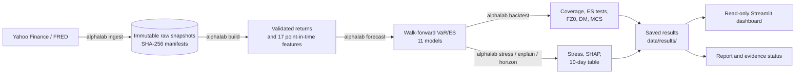
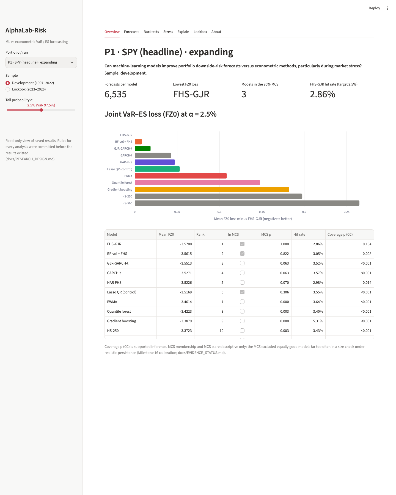
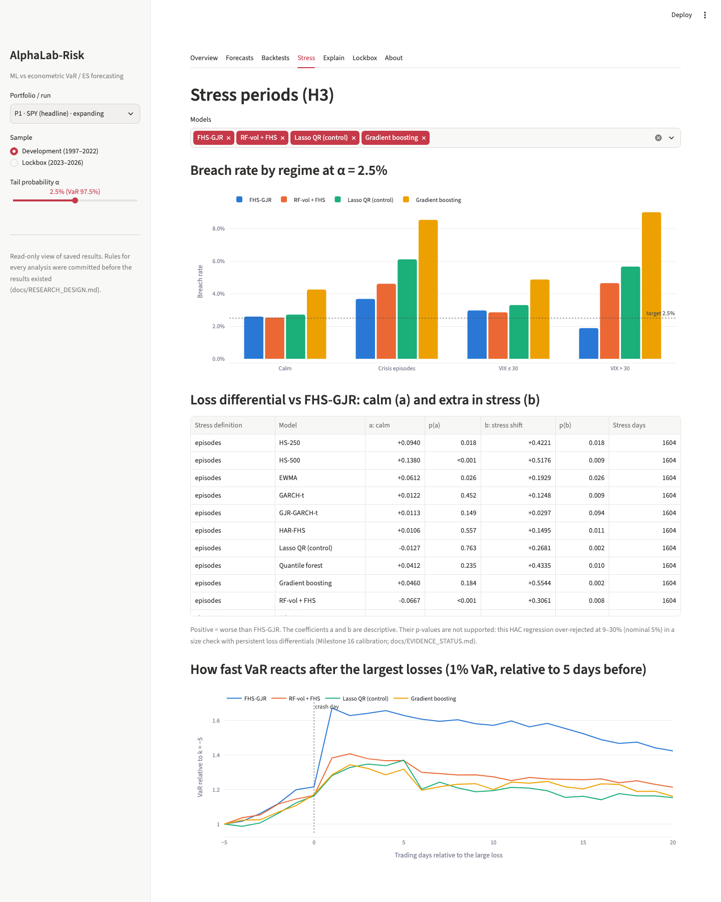
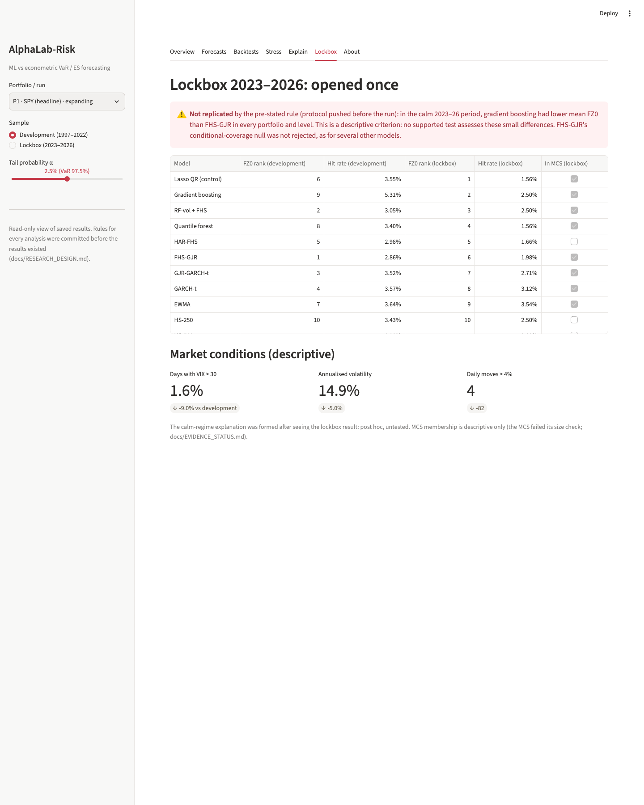

# AlphaLab-Risk

**Machine learning vs econometric models for portfolio Value-at-Risk and Expected Shortfall,
with a pre-registered design, a once-only held-out test and calibrated backtests.**

> Can machine-learning models improve the accuracy and robustness of portfolio downside-risk
> forecasts compared with traditional econometric methods, particularly during market stress?

*Value-at-Risk (VaR)* is the loss a portfolio should exceed only on a given small share of days
(for example 1 day in 100); *Expected Shortfall (ES)* is the average loss on those bad days.

MSc Finance research project (HEC Montréal, supervised-project pathway) by Guohuan Yu.
**Research report: [docs/REPORT.md](docs/REPORT.md)** (draft v2; a PDF version is proposed as an
asset of the v1.0 release).

---

## Why this question matters

Banks report 99% VaR and 97.5% Expected Shortfall under the Basel FRTB rules, and pension
funds and asset managers set risk budgets from the same numbers. Machine-learning models are
often proposed as replacements for GARCH-type models, but published comparisons frequently
lack strict out-of-sample discipline, proper scoring rules, an examination of crises, or a
check that the statistical tests used to compare models are reliable. This project tries to
do all four.

## What was done

| | |
|---|---|
| **Models (11)** | Historical simulation (250 and 500 days), EWMA, GARCH-t, GJR-GARCH-t, filtered historical simulation with GJR volatility (FHS-GJR), HAR-FHS, a lasso quantile-regression control, a quantile regression forest, gradient boosting, and a random-forest volatility model with FHS tails |
| **Portfolios (3)** | P1 SPY (headline), P2 a 60/40 multi-asset ETF portfolio, P3 Canadian equity (XIU.TO); plus a rolling-window robustness run |
| **Forecasts** | One-day VaR and ES at 99%, 97.5% and 95%; walk-forward, strictly out-of-sample, 1997–2022 development sample (6,535 forecasts per model on P1) |
| **Held-out test** | A 2023–2026 lockbox (≈ 961 days), opened exactly once under a protocol pushed to GitHub beforehand |
| **Pre-registration** | Hypotheses and analysis rules frozen at git tag `prereg-v1` before any GARCH, ML or lockbox result (only the historical-simulation and EWMA baseline results had been seen, and are logged); every later rule committed before the result it governs ([docs/RESEARCH_DESIGN.md](docs/RESEARCH_DESIGN.md)) |
| **Evaluation** | Kupiec, Christoffersen and Dynamic Quantile coverage tests; McNeil–Frey and Acerbi–Székely ES tests; FZ0 joint VaR–ES loss; Diebold–Mariano; Model Confidence Set; stress-episode analysis; SHAP and permutation importance |
| **Test calibration** | A frozen simulation study of every backtest's false-rejection rate under realistic persistence and heavy tails, reviewed independently before and after it ran ([docs/EVIDENCE_STATUS.md](docs/EVIDENCE_STATUS.md)) |

## Main findings, by strength of evidence

Each claim is labelled as in the report. **[Inference]**: a test whose size was checked and
found acceptable. **[Descriptive]**: a measured difference, with no significance claim.

1. **The ML models' VaR forecasts fail conditional coverage** in 11 or 12 of 12 development
   portfolio × level cells (Christoffersen test) [Inference]. FHS-GJR's conditional-coverage
   null is not rejected in 11 of 12 cells; that is a failure to find miscalibration, not proof
   of correct calibration.
2. **No ML model's average FZ0 loss was lower than FHS-GJR's by more than 0.002** in any P1
   development cell (the best, the RF-volatility hybrid, is within 0.012 at every level)
   [Descriptive].
3. **Every ML model loses ground relative to FHS-GJR in crisis episodes**, in all 36 model ×
   setting × level cells; a consistent calm-period advantage is concentrated in the
   RF-volatility hybrid [Descriptive].
4. **Tree models saturate outside their training range**: in October 2008 the forest-based
   99% VaR stayed at 3.8% while VIX reached 70 and FHS-GJR rose to 11.7% [Descriptive; a
   mechanism visible in the forecasts].
5. **Held-out lockbox: NOT REPLICATED.** By the pre-stated rule, gradient boosting had lower
   mean FZ0 than FHS-GJR in every portfolio and level of the calm 2023–2026 period. This is a
   descriptive criterion; it does not show that ML is significantly better [Descriptive].
6. **Standard model-comparison tests are unreliable on this kind of data.** In the
   calibration study, Diebold–Mariano rejected a true null up to 50% of the time at nominal
   5%, the Model Confidence Set wrongly excluded equally good models up to 99% of the time,
   and the stress regression over-rejected at up to 30%. Their p-values are therefore not
   used as evidence. Christoffersen's conditional-coverage test passed in every simulated
   design and sample length (P2/P3 lengths lie between the simulated ones: provisional).

**What this does not show:** that any model is statistically superior to another. The
comparative findings are consistent with a limited, regime-dependent role for ML (as a
volatility input rather than a direct tail model), but they are descriptive.

## Negative results and failed tests (kept on purpose)

- **Calibration failures** (Diebold–Mariano, MCS, stress regression, Acerbi–Székely Z2, most
  McNeil–Frey cells, DQ at 1%) are documented with their designs and rates in
  [docs/EVIDENCE_STATUS.md](docs/EVIDENCE_STATUS.md) and report §6.1.
- **ES regression backtest retired**: a Python port of the reference implementation (R
  `esreg`) passed its numerical checks, but its bootstrap p-values failed a pre-specified size
  check under dependent tail breaches (report §6.2; RESEARCH_DESIGN Addition 9).
- **All hypotheses' outcomes are reported**, including those not supported (H1 for ML, H2a,
  H2b, H4). Results are logged in the order they were seen ([docs/RESULTS_LOG.md](docs/RESULTS_LOG.md));
  methodological decisions and independent reviews are in [docs/DECISIONS.md](docs/DECISIONS.md).

## Main limitations

Comparative findings are descriptive because the comparison tests are mis-sized; "supported"
holds only within the simulated designs; about ten expected 99% breaches in the lockbox give
little power; univariate portfolio models; one market history; public data from Yahoo
Finance and FRED. Full list: [docs/LIMITATIONS.md](docs/LIMITATIONS.md).

## Architecture



| Area | Where |
|---|---|
| Data providers, snapshots, validation | `src/alphalab/data/` |
| Returns, trading calendars, look-ahead (truncation) checks | `src/alphalab/returns/`, `src/alphalab/core/` |
| Features | `src/alphalab/features/` |
| Risk models and walk-forward engine | `src/alphalab/risk/` |
| Backtests, ES tests, calibration study | `src/alphalab/backtest/` |
| Stress analysis, interpretability | `src/alphalab/stress/`, `src/alphalab/explain/` |
| Dashboard | `dashboard/app.py`, `src/alphalab/dashboard/` |
| Tests (341, offline) | `tests/` |

The package and command-line tool are called `alphalab` (the project began as an equity
research platform; that state is preserved at tag `v0.1-equity-research`).

## Installation and usage

Requires Python 3.12 and [uv](https://docs.astral.sh/uv/). macOS one-shot setup:
`bash scripts/setup_mac.sh` (its last steps download live data). Manual, any platform:

```bash
git clone https://github.com/Guohuan2026/alphalab-risk.git && cd alphalab-risk
uv venv --python 3.12 .venv && source .venv/bin/activate
uv pip install -e ".[dev]" -c requirements-lock.txt   # exact versions behind every result
make ci                                               # lint + 341 offline tests
make synthetic                                        # data pipeline (ingest + build) on synthetic data
```

The lock file matters: without it, `quantile-forest` 1.5.0 changes forest quantiles and the
results do not reproduce (report §10).

**Real data** (needs internet; see [docs/DATA.md](docs/DATA.md) for terms of use):

```bash
alphalab ingest   --config configs/risk_p1_spy.yaml   # download prices, VIX, FRED spreads
alphalab build    --config configs/risk_p1_spy.yaml
alphalab forecast --config configs/risk_p1_spy.yaml   # development sample only
alphalab backtest --config configs/risk_p1_spy.yaml
alphalab stress   --config configs/risk_p1_spy.yaml
```

Yahoo Finance revises history, so a new download need not match the snapshots behind the
logged results bit-for-bit; the original snapshots' hashes are recorded in each manifest.
The lockbox was opened once (2026-11-07) and must not be re-run as if it were held out.

**Calibration study:** `python -m alphalab.backtest.calibration diff` and `... es` (about 1.3
hours on 4 cores; seed fixed). **Report PDF:** `python -m alphalab.report_pdf` (needs Google
Chrome, at the macOS default path or set `ALPHALAB_CHROME`, and an internet connection for the
pinned `marked` and `mermaid` scripts; it stops with an error if the page did not render).

## Dashboard

```bash
make dashboard        # = streamlit run dashboard/app.py (reads data/results/)
```

A read-only view of the saved results with evidence-status notes next to every p-value. Tabs:
Overview (FZ0 ranking), Forecasts (VaR against realised losses), Backtests (coverage and ES
tests), Stress (breach rates by regime, reaction speed after large losses), Explain
(permutation importance, SHAP over time), Lockbox (development vs held-out), About. It never
fits a model. Without saved results it explains how to produce them.

<!-- Screenshots: add docs/images/dashboard_overview.png, dashboard_stress.png and
dashboard_lockbox.png (binary files are outside the automated publish workflow), then
uncomment:



-->

## Skills demonstrated

- **Quantitative risk:** VaR/ES modelling (GARCH family, filtered historical simulation,
  HAR), FRTB-relevant backtesting (Kupiec, Christoffersen, traffic light, ES tests),
  elicitable scoring (FZ0).
- **Econometrics and statistics:** HAC inference, Diebold–Mariano, Model Confidence Set,
  quantile regression, bootstrap methods, Monte Carlo size studies, fixed-b asymptotics.
- **Machine learning:** quantile forests, gradient boosting, random-forest volatility models,
  walk-forward tuning without leakage, SHAP and permutation importance.
- **Research integrity:** pre-registration, versioned amendments, held-out evaluation,
  independent review, honest reporting of negative results.
- **Engineering:** Python package with a CLI, 341 automated tests, look-ahead checks, CI on
  GitHub Actions, locked dependencies, hashed data snapshots, Streamlit dashboard.

## Development process

The project owner designed the research, made the methodological decisions and approved each
milestone. AI coding assistants (Claude Code; OpenAI Codex as an independent reviewer) were
used for implementation, checking and review, as recorded in the commit history and
`docs/DECISIONS.md`.

## Documentation

| | |
|---|---|
| [docs/REPORT.md](docs/REPORT.md) | Research report (draft v2) |
| [docs/EVIDENCE_STATUS.md](docs/EVIDENCE_STATUS.md) | Which results are supported inference, descriptive or unsupported, and why |
| [docs/RESEARCH_DESIGN.md](docs/RESEARCH_DESIGN.md) | Pre-registered design, deviations and amendments |
| [docs/RESULTS_LOG.md](docs/RESULTS_LOG.md) | Every result, in the order it was seen |
| [docs/METHODOLOGY.md](docs/METHODOLOGY.md) | Methods in detail |
| [docs/LIMITATIONS.md](docs/LIMITATIONS.md) | Limitations |
| [docs/DATA.md](docs/DATA.md) | Data sources, terms of use and how to obtain the data |
| [docs/SETUP_MACOS.md](docs/SETUP_MACOS.md) | Step-by-step macOS setup |
| [docs/DECISIONS.md](docs/DECISIONS.md) | Decision log and independent reviews |
| [docs/CHANGELOG.md](docs/CHANGELOG.md) | Changes by version |

## Licence

No licence has been chosen yet, so all rights are reserved by the author. Market data are not
included in this repository (see [docs/DATA.md](docs/DATA.md)).
