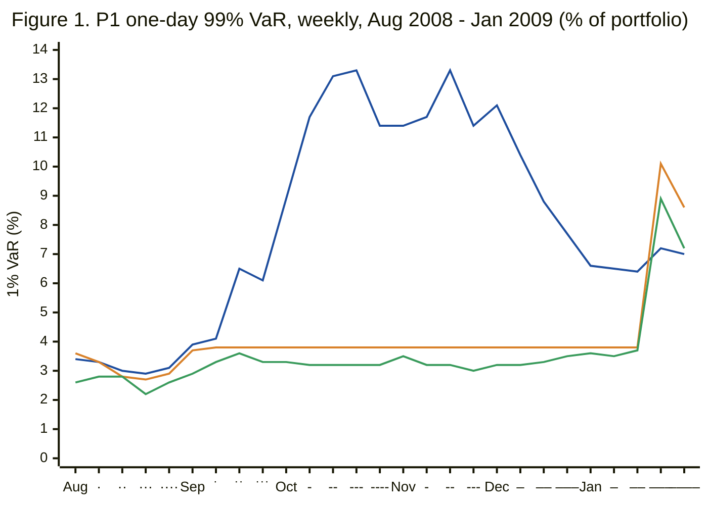
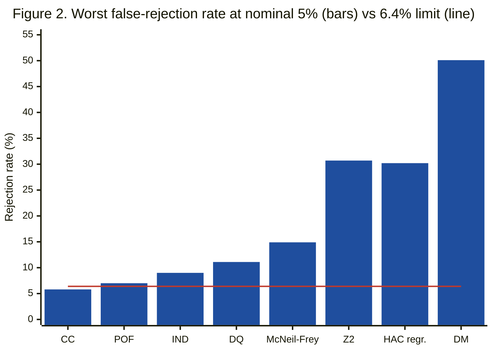

# AlphaLab-Risk: Machine Learning for Portfolio Risk Forecasting and Stress Resilience

**Research report, draft v2 (2026-11-12)** · supersedes draft v1 (2026-11-07)\
Guohuan Yu, MSc Finance (supervised-project pathway), HEC Montréal\
Code, data provenance and full history: `github.com/Guohuan2026/alphalab-risk` (private),
branch `alphalab-risk`. Every number below was re-checked against the saved result files
(`data/results/`) for this draft; the log of results in the order they were seen is
`docs/RESULTS_LOG.md`.

> **How to read this report.** Each claim carries one of four evidence labels, defined in
> §4.6 and justified test by test in `docs/EVIDENCE_STATUS.md`:
> **[Inference]** a test whose finite-sample size was checked and found acceptable for that
> sample length and level; **[Descriptive]** a measured difference, rank or rate with no
> claim of statistical significance; **[Exploratory]** an analysis added after the
> held-out lockbox was opened (development data only); **[Unsupported test]** a test that
> failed its size check, whose statistic is reported only as a description. Draft v1 used
> Diebold–Mariano, Model Confidence Set and HAC-regression p-values as evidence of
> significance; a frozen calibration study (§6.1) showed these tests over-reject badly on
> data like ours, so every such statement has been withdrawn or restated.

---

## Abstract

Can machine-learning (ML) models forecast portfolio downside risk better than the
econometric methods used by banks and asset managers, particularly during market stress? I
compare eleven one-day Value-at-Risk (VaR) and Expected Shortfall (ES) models on US equity
(SPY, the headline portfolio), a 60/40 multi-asset portfolio and Canadian equity (XIU.TO),
using strictly out-of-sample walk-forward forecasts, a design frozen before any GARCH, ML or
lockbox result existed (only baseline historical-simulation and EWMA results had been seen),
and a 2023–2026 lockbox opened exactly once. In the 1997–2022 development sample,
the ML models' VaR forecasts were rejected by Christoffersen's conditional-coverage test in
11 or 12 of 12 portfolio × level cells, while the conditional-coverage null for filtered
historical simulation with GJR-GARCH volatility (FHS-GJR) was not rejected in 11 of 12
[Inference]. No ML model's average joint VaR–ES (FZ0) loss was lower than FHS-GJR's by more
than 0.002 in any P1 development cell, and each ML model's loss relative to FHS-GJR was more
adverse in crisis episodes than in calm periods in all 36 model × setting × level cells
[Descriptive]. A mechanism is visible directly:
tree models cannot forecast risk outside their training range, so in October 2008 the
forest-based VaR stayed flat while VIX reached 70. In the calm lockbox the average-loss
ordering reversed: gradient boosting had lower mean FZ0 than FHS-GJR in every portfolio and
level, so the pre-stated replication rule returned **NOT REPLICATED** [Descriptive, by a
pre-stated rule]. FHS-GJR's conditional-coverage null was again not rejected, but so were
those of most other models, with only about ten expected breaches at 99%. Before
interpreting the comparisons I checked every test's size by simulation under realistic
persistence; the pairwise and multiple-comparison tests (Diebold–Mariano, Model Confidence
Set) and the stress regression failed, so the study's comparative findings are descriptive.
The evidence is consistent with a limited, regime-dependent role for ML (the hybrid that
uses ML only for volatility had lower loss than FHS-GJR in calm periods; direct ML tail
models did not), but it does not establish that any model is statistically superior.

---

## 1. Research question and contribution

> Can machine-learning models improve the accuracy and robustness of portfolio downside-risk
> forecasts compared with traditional econometric methods, particularly during periods of
> financial market stress?

**Why it matters.** Banks report 99% VaR and 97.5% ES under the Basel FRTB framework, and
pension funds and asset managers set risk budgets from the same quantities. ML methods are
increasingly proposed as replacements, but published comparisons often lack strict
out-of-sample discipline, proper scoring rules, or an examination of behaviour in crises,
the regime where risk models matter most.

**Hypotheses** (pre-registered at git tag `prereg-v1`):

| | Hypothesis | Pre-registered evidence | Status in this draft |
|---|---|---|---|
| H1 | ML VaR forecasts are correctly calibrated out-of-sample. | Kupiec, Christoffersen | **Not supported for ML** [Inference] |
| H2a | ML has lower joint VaR–ES loss than the best econometric model. | Mean FZ0, DM, MCS | **No evidence for H2a**; differences descriptive (DM/MCS unsupported) |
| H2b | Any ML gain comes from non-linearity, not merely from extra inputs (vs a linear model on the same features). | Mean FZ0, DM vs the lasso control | **No evidence for H2b**; descriptively reversed in the deep tail |
| H3 | Relative performance differs in stress periods. | Breach rates by regime; HAC stress-dummy regression | **Consistent with H3** [Descriptive]; not established by a validated test |
| H4 | ML forecasts respond to economically meaningful drivers, stably. | Three pre-stated criteria | **Not met** under the all-three rule [Descriptive] |

**Contributions.**
1. A like-for-like comparison: same data, horizon, confidence levels, information set and
   tuning protocol for every model.
2. A control model separating "better inputs" from "non-linearity" (H2b).
3. A stress analysis with ex-ante episodes, a VIX regime and reaction-speed event studies,
   and a concrete mechanism for why tree-based tail models fail in crises (saturation).
4. A frozen finite-sample calibration of every backtest used, which decided how strongly each
   result may be read (§6.1). This is a check of known asymptotic tests on realistic designs,
   not a new statistical method.
5. A research-integrity process (design freeze, pre-committed clarifications, results log,
   once-only lockbox, bit-identical reproduction, versioned amendments) that a
   model-validation team can audit.

## 2. Background

**VaR and ES.** With loss L = −r and tail probability α, VaR_α is the loss exceeded with
probability α, and ES_α = E[L | L ≥ VaR_α] is the mean loss beyond it. ES captures tail
severity, which VaR ignores; that is why FRTB moved capital to ES at 97.5%.

**Elicitability.** To *rank* forecasts we need a scoring rule whose expected value is
minimised by the true forecast. Quantiles (VaR) have one: the tick loss. ES alone does not
(Gneiting 2011), but the pair (VaR, ES) does (Fissler & Ziegel 2016). I use the FZ0 loss of
Patton, Ziegel & Chen (2019); lower (more negative) is better.

**Models.** GARCH (Bollerslev 1986) and GJR-GARCH (Glosten, Jagannathan & Runkle 1993)
capture volatility clustering and the leverage effect; FHS (Barone-Adesi et al. 1999)
combines GARCH volatility with empirical residual tails; HAR (Corsi 2009) models volatility
over daily, weekly and monthly horizons; quantile regression forests (Meinshausen 2006) and
gradient boosting with the pinball loss are the main ML quantile learners.

**Backtests and their known weak points.** Coverage tests (Kupiec 1995; Christoffersen 1998)
and the Dynamic Quantile test (Engle & Manganelli 2004) rely on χ² approximations that are
known to be imprecise with few breaches; DQ in particular is over-sized at low α and moderate
samples (Dumitrescu, Hurlin & Pham 2012). Diebold–Mariano (1995) tests and the Model
Confidence Set (Hansen, Lunde & Nason 2011) rely on heteroskedasticity-and-autocorrelation
consistent (HAC) or block-bootstrap approximations whose accuracy depends on how persistent
the loss differentials are; fixed-b asymptotics (Kiefer & Vogelsang 2005) are one response.
These known issues motivated the calibration study in §6.1.

## 3. Data

| Portfolio | Composition | Calendar | Out-of-sample development | Lockbox |
|---|---|---|---|---|
| **P1 (headline)** | SPY total return (dividends included) | NYSE | targets 1997-01-15 → 2022-12-30 (6,535 forecasts) | 2023-01-03 → 2026-10-30 (≈ 961) |
| P2 | 40% SPY, 20% EFA, 30% IEF, 10% LQD, monthly rebalance | NYSE | 2006-07 → 2022-12 (4,142) | same |
| P3 | XIU.TO (S&P/TSX 60), CAD | TSX | 2003-09 → 2022-12 (4,838) | same |

**Sources.** Prices, dividends and VIX from Yahoo Finance; credit (Moody's Baa − 10y) and term
(10y − 3m) spreads from FRED. Every download is an immutable snapshot with a SHA-256 hash;
each build records the snapshot it used.

**Features** (17, all stamped with information published by the end of day t): realized
variance over 1/5/22/66 days (HAR structure), Parkinson and Garman–Klass range variance,
drawdown from the forward-built wealth index, VIX and its 5-day change, and the two spreads
with their 22-day changes. FRED series are lagged one session (they are published the next
morning).

**Data quality.** Total returns are built from raw closes plus dividends, never from Yahoo's
backward-adjusted levels, which embed future information. Three XIU.TO year-end
distributions that were reinvested rather than paid are treated as non-cash (an explicit,
logged correction; raw data untouched). SPY tracks the S&P 500 total-return index to within
0.13%/yr, but daily agreement is weaker before 2009 (a documented open limitation).

## 4. Methodology

### 4.1 The forecast contract

All models forecast the next day's loss at α ∈ {1%, 2.5%, 5%} (99%, 97.5% and 95% VaR/ES).
Main specification: expanding estimation window with at least 1,000 sessions, parameters
re-estimated every 21 sessions, filters updated daily. Feature-based models refit and
re-tune yearly (Deviation 3), which handicaps ML relative to the monthly econometric refits.
A walk-forward engine produces one forecast per day using only data up to that day. An
engine-level truncation test checks that a forecast computed on data cut off at date d
equals the one computed in the full run.

### 4.2 Models

| Family | Model | VaR / ES from |
|---|---|---|
| Baselines | HS-250, HS-500 | empirical quantile and tail mean of past losses |
| | EWMA (RiskMetrics, λ = 0.94) | normal quantiles × EWMA volatility |
| Econometric | GARCH(1,1)-t, GJR-GARCH(1,1)-t | Student-t quantiles × GARCH volatility (`arch`) |
| | **FHS-GJR** | GJR volatility × empirical quantiles of standardised residuals |
| Linear | HAR-FHS | OLS volatility on 1/5/22-day realized variance + FHS tails |
| | **Lasso QR (H2b control)** | L1-penalised linear quantile regression on the 17 features |
| ML | Quantile regression forest (QRF) | forest leaf distributions (`quantile-forest`) |
| | Gradient boosting (GBQ) | one pinball-loss model per quantile level (scikit-learn) |
| | RF-volatility + FHS ("hybrid") | random forest for \|r\| (a volatility proxy) × out-of-bag residual tails |

ES for the quantile models is the average of predicted quantiles at α(k − ½)/5, k = 1…5. A
safety floor (VaR ≥ 1 bp, ES ≥ VaR) applies to every model (Deviation 2).

**Tuning.** One shared protocol for all ML models and the control. Hold out the last 20% of
each training window with a one-day embargo, evaluate small grids fixed in advance with the
mean tick loss, refit the best configuration on the whole window. Seeds are fixed.

### 4.3 Leakage safeguards

Every feature passes a truncation test, and the label (next-day loss) is checked to *fail*
it. Scalers and clipping bounds are fitted on training data only. Stress regimes are used only
to split the evaluation, never as inputs. The lockbox was enforced in code: forecasts into it
required an explicit flag.

### 4.4 Evaluation

- **Calibration:** Kupiec (breach frequency, "POF"), Christoffersen independence ("IND") and
  conditional coverage ("CC"), Engle–Manganelli Dynamic Quantile ("DQ": are breaches
  predictable from past breaches or from the VaR level itself?), Basel traffic light.
- **ES:** McNeil–Frey exceedance-residual test (bootstrap) and its severity ratio (realised
  mean tail loss / forecast ES); Acerbi–Székely Z2 (frequency and severity of breaches
  together; Monte Carlo p-value under a shape-matched Student-t null, Clarification 7).
- **Ranking:** mean FZ0 and tick loss; Diebold–Mariano tests with Newey–West errors (lag
  ⌊4(n/100)^{2/9}⌋); the Model Confidence Set at 90%.
- **Stress:** eight ex-ante episodes (by target date) and a VIX-above-30 regime (at the
  forecast origin); loss differentials regressed on an episode dummy with HAC errors; an
  event study of VaR reaction after the largest losses.
- **Interpretability:** permutation importance on each yearly validation window; TreeSHAP
  attributions to VaR; three pre-stated criteria (concentration, economic sign, stability).

Before market data, every test was checked on simulated GJR-GARCH-t data with known true VaR
and ES (FZ0 ranks the true model first; tests roughly correctly sized *under independence*).
That check did not cover persistent, heavy-tailed loss differentials, which is why §6.1 was
added.

### 4.5 Research integrity

The design was frozen at tag `prereg-v1` before any GARCH, ML or lockbox result existed (only
baseline HS/EWMA results had been seen, and they are logged). Later decisions were committed
before the results they govern (Deviations and Clarifications in `RESEARCH_DESIGN.md`;
timeline in Appendix A). Every result is logged in the order it was seen. The lockbox
protocol, including the rule for "replicated", was pushed to GitHub before the lockbox was
opened. Everything added after the lockbox was opened (DQ, Z2, the ten-day table, the ES
regression work and the calibration study) is labelled exploratory and uses development data
or simulation only.

### 4.6 Evidence classification

| Label | Meaning | Tests |
|---|---|---|
| **[Inference]** | Size within the frozen tolerance (≤ 6.4% at nominal 5%) in every gated simulation design for that sample length and α | Christoffersen CC (all cells); IND (except lockbox length at 5%); Kupiec (except lockbox length at 1%); DQ at 5% (and 2.5% at T ≈ 6,500) |
| **[Descriptive]** | Measured means, ranks, rates, coefficients; no significance claim | FZ0/tick means and ranks, hit rates, severity ratios, regime breach rates, SHAP, horizon table |
| **[Exploratory]** | Added after the lockbox was opened | DQ, Z2, ES regression, ten-day table, calibration study |
| **[Unsupported test]** | Failed its size check; statistic shown only as a description | Diebold–Mariano, MCS, HAC stress regression, Z2, McNeil–Frey (most cells), DQ at 1%, ES regression (retired) |

"Supported" means size control within the simulated designs (§6.1); it says nothing about
power. P2 and P3 (≈ 4,100–4,800 forecasts) lie between the two simulated lengths (961 and
6,535); a test that passed at both is treated as *provisionally* supported there, by
endpoint checks: an interpolation heuristic, not guaranteed size control at those lengths.
Kupiec's POF was gated only on designs with independent breaches; under clustered breaches it
over-rejects even when the overall breach rate is right, so CC is the primary test.
Statistics of unsupported tests are quoted as descriptions only; where a p-value from such a
test is mentioned, it is to document what draft v1 claimed.

## 5. Results

### 5.1 Calibration (H1)

**P1, development (6,535 forecasts; ≈ 65 expected breaches at 1%).**

| Model | 1% hits | 2.5% hits | 5% hits | CC p (1 / 2.5 / 5%) [Inference] |
|---|---|---|---|---|
| **FHS-GJR** | **1.13%** | **2.86%** | **5.37%** | **0.32 / 0.15 / 0.36** |
| HAR-FHS | 1.29% | 2.98% | 5.81% | <0.001 / 0.014 / 0.012 |
| GJR-GARCH-t | 1.39% | 3.52% | 6.12% | 0.004 / <0.001 / <0.001 |
| RF-vol + FHS | 1.45% | 3.05% | 5.91% | <0.001 / 0.008 / <0.001 |
| Lasso QR (control) | 1.65% | 3.55% | 6.63% | <0.001 at every level |
| Quantile forest | 1.76% | 3.40% | 6.06% | <0.001 at every level |
| Gradient boosting | 2.92% | 5.31% | 8.28% | <0.001 at every level |
| EWMA | 2.08% | 3.64% | 5.95% | <0.001 / <0.001 / 0.002 |
| HS-250 | 1.56% | 3.43% | 5.71% | <0.001 at every level |

**Across the four development settings** (P1, P2, P3, P1 rolling window; 12 cells per model),
CC rejections at 5% [Inference]: FHS-GJR 1 of 12 (P2 at 1%: hit rate 1.40%, p = 0.027);
HAR-FHS 6; lasso control 9; quantile forest, RF-vol hybrid and EWMA 11; gradient boosting,
GARCH-t, GJR-t and both HS models 12. On P1, FHS-GJR is the only model not rejected by
Kupiec or Christoffersen at any level; on P3, HAR-FHS and the lasso control are also never
rejected by CC.

**H1 is not supported for the ML models** [Inference]: each is rejected in 11 or 12 of 12
cells. For FHS-GJR the correct reading is that *its conditional-coverage null was not
rejected* in 11 of 12 development cells; that is a failure to find miscalibration with a
test of known size, not proof of correct calibration.

**Observed diagnostics and interpretation** [Descriptive]. HS's breaches cluster (rejected
by IND in all 12 cells), consistent with slow reaction. EWMA's realised tail losses exceed
its forecast ES by 14% at 2.5% on P1 (severity ratio 1.14), consistent with normal tails
being too thin. The t-GARCH models breach too often (GJR-t 1.39% at 1%), while FHS-GJR,
which replaces the t quantile with empirical residual quantiles, breaches 1.13%; one
plausible interpretation is that SPY's negatively skewed losses are poorly matched by a
symmetric t, but this mechanism was not tested.

**Dynamic Quantile test** [Exploratory; development only]. DQ asks whether breaches are
predictable from past breaches and from the VaR level. Its size was acceptable at 5% (both
simulated lengths) and at 2.5% for T ≈ 6,500, but not at 1% (7.8–11.1%) or at 2.5% for
short samples, so 1% DQ results are descriptive and P2/P3 at 2.5% are provisional.

| Setting (forecasts) | FHS-GJR DQ p, 1% | 2.5% | 5% | Other ten models |
|---|---|---|---|---|
| P1 (6,535) | 0.019 [descriptive] | **0.002** [Inference] | **0.011** [Inference] | rejected at 2.5% and 5%, all ten |
| P1 rolling (6,535) | <0.001 [descriptive] | 0.073 [Inference] | **0.025** [Inference] | rejected at 2.5% and 5%, all ten |
| P2 (4,142) | <0.001 [descriptive] | 0.041 [provisional] | **0.015** [Inference] | rejected at 2.5% and 5%, all ten |
| P3 (4,838) | 0.14 [descriptive] | 0.64 [provisional] | 0.43 [Inference] | rejected at 2.5% and 5%, all ten |

So at 5%, DQ rejects every model on P1, P2 and the P1 rolling window, and every model except
FHS-GJR on P3 [Inference]. FHS-GJR is the least-rejected model (DQ p < 0.05 in 8 of 12 cells
including the descriptive 1% cells; every other model 11 or 12). For FHS-GJR the
predictability comes from the VaR level rather than breach clustering [Descriptive]: on P1
its 1% breach rate is 1.50% when its VaR is below the median and 0.76% when above (overall
1.13%, conditional coverage not rejected): too many breaches when forecast risk is low and
too few when it is high.

**ES tests** [Unsupported test; development only for Z2]. McNeil–Frey and Z2 over-rejected
in the calibration study whenever volatility dynamics were misspecified, so their p-values
are descriptive. As descriptions: FHS-GJR's P1 severity ratios are 0.989 / 0.975 / 0.981
(realised tail losses close to forecast ES); Z2 is negative for every model on P1 (risk
understated on average), smallest in magnitude for FHS-GJR.

### 5.2 Accuracy (H2)

FZ0 rank among 11 models and mean FZ0 (P1, development) [Descriptive]:

| Model | Rank 1% | Rank 2.5% | Rank 5% | Mean FZ0 (1 / 2.5 / 5%) |
|---|---|---|---|---|
| FHS-GJR | **1** | **1** | 2 | −3.338 / −3.570 / −3.755 |
| RF-vol + FHS | 2 | 2 | **1** | −3.326 / −3.562 / −3.756 |
| GJR-GARCH-t | 3 | 3 | 3 | −3.320 / −3.551 / −3.745 |
| Lasso QR (control) | 4 | 6 | 10 | −3.317 / −3.517 / −3.574 |
| Quantile forest | 9 | 8 | 7 | −3.057 / −3.422 / −3.648 |
| Gradient boosting | 10 | 9 | 8 | −3.030 / −3.388 / −3.635 |

- **H2a: no evidence.** The best ML model, the RF-volatility hybrid, has mean FZ0 within 0.012
  of FHS-GJR at every level (lower only at 5%, by 0.0015; no economic-significance threshold
  was pre-specified, so the exact differences are reported), and is worse calibrated (§5.1).
  The direct-quantile models' mean FZ0 is 0.12–0.31 higher than FHS-GJR's. Draft v1 called
  these differences significant using Diebold–Mariano; that test was found to over-reject by
  a factor of 3–10 under realistic persistence (§6.1), so no significance is claimed.
- **H2b: no evidence, descriptively reversed in the deep tail.** At 1% and 2.5% the linear
  control has lower mean FZ0 than both direct-quantile ML models, and gradient boosting's 1%
  VaR is breached 2.9× as often as it should be (a rejection by CC, [Inference]). With only
  about 10–84 training observations below the 1% quantile, trees struggle to learn the
  extreme tail. ML helped only in the hybrid design, which uses it to model volatility and
  lets the residuals supply the tail.

### 5.3 Stress (H3)

The eight crisis episodes cover 1,604 of 6,535 P1 development days; the VIX-above-30 regime
covers 688.

**Breach rates at 1% by regime (P1)** [Descriptive]:

| Model | Calm | Crisis episodes | VIX > 30 |
|---|---|---|---|
| FHS-GJR | 1.05% | **1.37%** | **1.02%** |
| RF-vol + FHS | 1.05% | 2.68% | 3.05% |
| Quantile forest | 1.03% | 3.99% | 5.38% |
| Gradient boosting | 2.21% | 5.11% | 5.52% |
| HS-250 | 0.75% | 4.05% | 4.07% |

**Loss differential by regime** [Descriptive; the HAC regression's p-values are an
Unsupported test]. Regressing the FZ0 differential (model minus FHS-GJR) on an episode dummy
gives, for the hybrid on P1, a calm-period difference of −0.105 / −0.067 / −0.050 (hybrid
better) and a crisis shift of +0.48 / +0.31 / +0.20 (hybrid worse); the two roughly cancel
over the full sample, which is why its overall rank ties FHS-GJR. The crisis shift is positive
for each of the three ML models in all 36 model × setting × level cells (P1, P2, P3, P1
rolling); these cells are strongly correlated, so this is descriptive consistency, not 36
independent confirmations. A calm-period advantage is specific to the hybrid: its calm
difference is negative on P1, P2 and the rolling window and near zero on P3, whereas the
quantile forest and gradient boosting have higher loss than FHS-GJR in calm periods too
(positive calm difference in 23 of their 24 cells). Draft v1 reported p-values of 0.0015 and 0.015 for these effects; the HAC
regression over-rejected at 9–30% under realistic persistence (§6.1), so they are withdrawn.

**Reaction speed** [Descriptive; 66 largest-loss events on P1]. The day after one of the 1%
largest losses, the GJR and FHS-GJR VaR rises 67%; HAR-FHS and EWMA 37–41%; the quantile
forest and gradient boosting 23–29% and the RF-vol hybrid 38%. None of the three forest or
boosting models reaches 1.5× its pre-shock level within the event window.

**H3 status.** Relative performance does differ by regime in the descriptive sense: every ML
model's loss relative to FHS-GJR worsens in crises in every setting and level, and only the
hybrid is ahead in calm periods. No validated test establishes either pattern. Consistency of sign across correlated settings is not
a substitute for a test.

### 5.4 Interpretability (H4) and the saturation mechanism

| Model | C1: top-3 drivers are volatility/VIX | C2: economic signs | C3: stability ≥ 0.6 |
|---|---|---|---|
| RF-vol + FHS | ✓ (VIX, gk_5, gk_1) | ✗ (9/11 positive) | ✗ (0.54) |
| Quantile forest | ✓ (gk_5, VIX, pk_1) | n/a (no TreeSHAP for quantiles) | ✗ (0.35) |
| Gradient boosting | ✗ (credit-spread change 3rd) | ✗ (8/11) | ✓ (0.69) |

**H4 is not met** under the pre-stated all-three rule [Descriptive]. The direction is
sensible: VIX and range-based volatility dominate, and VIX's contribution rises with its
level. But signs of correlated volatility features are unreliable, and importance rankings
shift from year to year.

**Saturation** [Descriptive]. The hybrid in use during 2008 had been trained on data whose
maximum VIX was 45.7. Its 1% VaR was 3.81% on 12 September 2008 (VIX 25.7) and 3.82% on
10 October 2008 (VIX 69.9), with identical SHAP contributions: both days fall in the same
leaves. FHS-GJR moved from 4.12% to 11.73%. A tree cannot forecast a risk level outside its
training range; GARCH extrapolates through its recursion.

*Figure 1.* Blue (rising): FHS-GJR. Orange (flat at 3.8%): RF-vol + FHS hybrid. Green
(lowest): quantile forest. Ticks are Friday values; month names mark each month's first week. VIX rose from 25.7 (12 Sep) to 79.1 (24 Oct). The forest-based forecasts
stay capped until their scheduled yearly refit in January 2009, when the training data first
include autumn 2008. Source: `forecasts.parquet` (P1 development run).

### 5.5 Robustness [Descriptive]

| Setting | FHS-GJR FZ0 rank (1/2.5/5%) | RF-vol + FHS rank | Quantile forest / boosting ranks |
|---|---|---|---|
| P1, expanding (main) | 1 / 1 / 2 | 2 / 2 / 1 | 9, 8, 7 / 10, 9, 8 |
| P2, 60/40 | 1 / 1 / 1 | 6 / 7 / 7 | 10, 9, 8 / 11, 11, 10 |
| P3, Canada | 1 / 1 / 1 | 5 / 3 / 3 | 8, 9, 9 / 9, 8, 8 |
| P1, rolling 1,000 days | 1 / 1 / 1 | 5 / 5 / 5 | 10, 10, 8 / 11, 11, 11 |

FHS-GJR has the lowest mean FZ0 in 11 of 12 cells. The hybrid's calm-period advantage seen on
P1 is much weaker elsewhere.

**Ten-day horizon** [Descriptive; Exploratory, Clarification 8]. Each model's one-day forecast
was scaled by √10 (the Basel square-root-of-time rule) and compared with the compounded loss
over the next 10 sessions in non-overlapping windows (P1: 653 windows, 6.5 breaches expected
at 1%). Scaled FHS-GJR had 7, 16 and 32 breaches against 6.5, 16.3 and 32.7 expected. At 1%,
√10 scaling understates risk: breaches exceed the expected count in 41 of 44 model × setting
cells (median 1.7×). The counts are too small to test.

### 5.6 Lockbox 2023–2026: NOT REPLICATED

The lockbox was opened once (protocol commit `dc8af86`, pushed before the run), about 961
forecasts per portfolio. Integrity check: re-forecasting the development period inside the
lockbox run reproduced the saved forecasts bit-for-bit for all three portfolios.

**The pre-stated rule.** The development findings were to be read as *consistent* with the
lockbox if (a) FHS-GJR is in the lockbox MCS at 2.5% and 5% **and** (b) neither the quantile
forest nor gradient boosting has lower mean FZ0 than FHS-GJR; otherwise *not replicated*.

**Result.** Condition (b) fails in every portfolio: gradient boosting's mean FZ0 is lower than
FHS-GJR's at every level in P1, P2 and P3 (by 0.06 / 0.10 / 0.06, 0.13 / 0.08 / 0.04 and
0.02 / 0.03 / 0.01), and the quantile forest's is lower at 2.5% and 5% in P1 and at all three
levels in P2. Because (b) alone is sufficient, the verdict **NOT REPLICATED** holds whatever
the MCS does, so it does not depend on the unsupported MCS.

**What the verdict does and does not mean.** It is a pre-specified descriptive criterion: the
development ordering did not carry over to 2023–2026. It does **not** show that ML is
statistically better in the lockbox: the differences are small, there are about 10 expected
breaches at 1% and 48 at 5%, and the Diebold–Mariano test that would assess them is
unsupported (nominal p-values of FHS-GJR against the ML models and the control on P1 ranged
from 0.04 to 0.65; descriptive only).

**P1 lockbox** [Descriptive except CC]:

| Model | FZ0 rank (1 / 2.5 / 5%) | Hit rates (1 / 2.5 / 5%) | CC p [Inference] |
|---|---|---|---|
| Lasso QR (control) | 1 / 1 / 1 | 0.73% / 1.56% / 4.37% | 0.08 / 0.06 / 0.45 |
| RF-vol + FHS | 2 / 3 / 3 | 1.14% / 2.50% / 4.16% | 0.26 / 0.87 / 0.41 |
| Gradient boosting | 3 / 2 / 2 | 1.35% / 2.50% / 5.20% | 0.22 / 0.87 / 0.92 |
| Quantile forest | 7 / 4 / 4 | 0.83% / 1.56% / 3.95% | 0.13 / 0.06 / 0.15 |
| **FHS-GJR** | 5 / 6 / 5 | **1.04% / 1.98% / 4.79%** | **0.89 / 0.37 / 0.63** |
| GJR-GARCH-t | 6 / 7 / 7 | 1.56% / 2.71% / 6.14% | 0.21 / 0.86 / 0.19 |

**Calibration in the lockbox** [Inference, with low power]. FHS-GJR's conditional-coverage
null is not rejected in any of the 9 portfolio × level cells. The same holds for gradient
boosting, the RF-vol hybrid, the lasso control and HAR-FHS (0 of 9 each). With about ten
expected breaches at 1%, the lockbox cannot distinguish these models' calibration; it shows
only that none of them was detectably miscalibrated in a calm period.

**Market conditions** [Descriptive; values logged when the lockbox was opened]. VIX was
above 30 on 1.6% of lockbox days against 10.5% in development; annualised SPY volatility was
14.9% against 19.9%; there were 4 daily moves larger than 4% against 86. Combined with the
stress pattern in §5.3, the reversal is consistent with a regime effect. **That explanation
was formed after seeing the result; it is untested and labelled post hoc.** The lockbox
contains essentially no stress, so it cannot test stress robustness.

## 6. Methodological validation

### 6.1 Finite-sample calibration of the backtests [Exploratory; simulation only]

**Why.** The ES-regression backtest failed its own validation under dependence (§6.2). That
raised the question of whether the other tests are reliable on data like ours. Real P1 FZ0
differentials are extremely heavy-tailed (kurtosis 60 to over 6,000) and persistent (their
long-run variance estimated with 100 lags is up to 4.5–5 times their variance for the
ML-vs-FHS pairs).

**Design (frozen before running; RESEARCH_DESIGN Addition 10).** Simulated null worlds in
which the hypothesis tested is true by construction: loss differentials with Student-t(3)
shocks, stochastic volatility, the real crisis-episode calendar (shock scale doubled,
variance quadrupled, in episodes) and a slowly mean-reverting zero-mean component, in designs matched (on
autocorrelation and long-run-variance statistics only, never on test outcomes) to the median
and upper range of the real series; i.i.d. designs as sanity checks; VaR/ES forecasts that
are correct, or correct on average with missed volatility dynamics, or with misspecified tail
shape. Sample lengths 6,535 and 961; 2,000 replications; seed 20261112. A test is supported
at a given length and level only if its 5% rejection rate is at most 6.4% in every gated
design (11.9% for the MCS at 90%). Pre-declared fallbacks: fixed-b Diebold–Mariano (b = 0.1)
and a 40-day MCS block. An independent review (Codex) before the run added a harder design
and stricter completeness rules; a review after the run confirmed the classifications.

**Results** (worst gated design; nominal 5% unless stated):

| Test | T = 6,535 | T = 961 | Verdict |
|---|---|---|---|
| Diebold–Mariano (Newey–West) | 46.3% | 50.1% | Unsupported; fixed-b fallback also fails (7.6% / 20.7%) |
| HAC stress-dummy regression | 30.2% | 30.2% | Unsupported |
| MCS, false exclusion at 90% (limit 11.9%) | 98.5% | 99.2% | Unsupported; 40-day block also fails |
| Christoffersen CC | ≤ 5.8% | ≤ 5.6% | Supported at every level |
| Christoffersen IND | ≤ 6.2% | 9.0% at 5% | Supported except T = 961 at 5% |
| Kupiec POF | ≤ 6.4% | 7.0% at 1% | Supported except T = 961 at 1% |
| Dynamic Quantile | 7.8% at 1% | 11.1% at 1%, 7.5% at 2.5% | Supported at 5% (and 2.5% for T = 6,535) |
| McNeil–Frey | 8.0–14.9% at 2.5–5% | no result in up to 37% of samples | Unsupported in most cells |
| Acerbi–Székely Z2 | 13.6–30.7% | 13.6–26.5% | Unsupported |

*Figure 2.* Blue bars: worst rate over designs, sample lengths and levels; red line: the 6.4% limit. The MCS (false exclusion up
to 99% at a 10% nominal level) is off this scale.

**Interpretation.** With independent differentials, DM (4–5%) and the regression (5–6%) are
correctly sized, which is consistent with persistence driving the failures; these sanity
checks do not by themselves rule out every implementation error. Even
the design matched to the *median* real statistics gives DM 14–17%, the regression 9–11% and
MCS false exclusions of 39–53%. The magnitude of the distortion depends on persistence beyond
lag 100, which a sample of this length cannot pin down; the results show that these tests
are vulnerable under designs that match the observed statistics, not the exact distortion in
the real series. A "supported" verdict holds only within the simulated designs. Coverage tests
are robust for a structural reason: under their null breaches are independent, so dependence
is the alternative they are meant to detect, not a nuisance.

### 6.2 The ES regression backtest: a negative validation result [Exploratory]

The Bayer & Dimitriadis (2022) ES regression (ESR) backtest was added after the lockbox to
complement the McNeil–Frey test. I ported the reference implementation (R package `esreg`)
to Python and matched it on fixed inputs (to 10 digits once esreg's rule for zero residuals
is applied), then checked the bootstrap
p-values by simulation before using them:
- The asymptotic p-values over-rejected under serially dependent tail breaches.
- The pre-registered block bootstrap was unusable: its auxiliary scale model ended on a
  zero-variance boundary in 22–32% of dependent samples, which an audit traced to an
  unbounded likelihood; 2,479 saved bootstrap draws for one model had been silently
  degenerate and were quarantined.
- An amended bootstrap (esreg's independence covariance, specified before results)
  over-rejected at 11.7% and 25.4% (strict test) at nominal 5%, against a 6.4% limit.

ESR p-values were therefore retired; its estimates remain as descriptive diagnostics. Finite-sample
size distortions of ES regression tests have already been reported in the literature, so the contribution here is not a new finding about ESR but a
documented example of pre-specified validation catching a mis-sized test before it entered
the conclusions, and the prompt for §6.1.

## 7. Discussion

**What the evidence supports.** Three findings rest on validated tests or on measurements
that need no test:
1. The ML models' VaR forecasts fail conditional coverage in the development sample, while
   FHS-GJR's conditional-coverage null is not rejected in 11 of 12 cells [Inference].
2. At 5%, breaches of every model are predictable (DQ), except FHS-GJR on P3 [Inference]. A
   well-calibrated average does not mean correct conditional behaviour: FHS-GJR breaches too
   often when its VaR is low.
3. Tree-based tail forecasts saturate outside their training range (Figure 1), a mechanical
   property visible in the forecasts themselves.

**What the evidence suggests but does not establish.** The comparative picture (FHS-GJR's
lowest average loss in 11 of 12 development cells, the hybrid's calm-period gain, every ML
model's relative loss in crises, the lockbox reversal) is consistent across portfolios and windows, but rests on descriptive
comparisons, because the pairwise tests that would assess it are mis-sized on these data.
The regime interpretation of the lockbox is post hoc.

**What ML is and is not good for in VaR/ES (as a working hypothesis).** ML appears more useful
as a *volatility* model fed with rich information (VIX, range-based variance) than as a
direct *tail* model: there are few tail observations, and trees cannot extrapolate. The
hybrid design is the natural architecture to test next.

**Practical implications.**
- *Bank market risk / model validation:* the results favour retaining a GARCH-filtered
  historical simulation model as the benchmark and requiring any ML challenger to pass
  conditional-coverage tests and a stress (out-of-range) check. They also show that
  model-comparison p-values from standard DM or MCS procedures can be badly over-confident on
  daily risk data, which matters for challenger-model governance (e.g. OSFI E-23).
- *Pension funds and asset managers* who weight calm-period average accuracy more heavily
  might use ML-informed volatility in calm regimes, with a guard for stress.
- A regime switch (for example on VIX) or a max(ML, GARCH) rule is the natural next
  hypothesis. It was **not** tested here, because adding it after seeing the results would be
  post hoc; it would need new data or a new frozen design.

## 8. Limitations

1. **Inference on model comparisons.** Diebold–Mariano, the MCS and the stress regression
   failed their size checks; comparative conclusions are descriptive. Dependence-robust
   alternatives (larger-bandwidth fixed-b, subsampling) were not validated.
2. **Scope of the calibration study.** "Supported" holds within the simulated designs; real
   persistence beyond lag 100 is not identified. P2/P3 lengths were not simulated directly.
3. **Statistical power.** About 65 expected 1% breaches in development but only about 10 in
   the lockbox; crisis cells at 1% are thin. Non-rejections at 1% are weak evidence.
4. **Univariate portfolio approach.** Each portfolio is modelled as one return series with
   fixed weights; no multivariate (DCC, copula) models.
5. **One market history.** A handful of crises; future crises may differ.
6. **Public data.** Yahoo is unofficial and restates history (immutable snapshots mitigate
   this); no intraday realized volatility; SPY's daily agreement with the index is weaker
   before 2009.
7. **Implementation details.** The quantile forest used the library default of one training
   value per leaf, coarser than Meinshausen's original, and its results depend on the library
   version (locked). HAR coefficients are attenuated because daily squared returns are noisy
   proxies. Gradient boosting's per-level quantiles crossed on 66% of days.
8. **Control-model changes.** The lasso control and the safety floor were chosen after seeing
   the plain linear control fail (Deviation 2); the change strengthens the control, which is
   conservative for H2b.
9. **Tuning budget.** Small fixed grids, chosen for honesty and compute; richer searches might
   help ML.
10. **Post-lockbox analyses.** DQ, Z2, ESR, the ten-day table and the calibration study were
    added after the lockbox was opened and use development data or simulation only.

Full list: `docs/LIMITATIONS.md`.

## 9. Industry adaptation (Mitacs partnership)

The pipeline is built to take a partner's own data: the provider interface accepts any price
or P&L series, portfolios are configured by weights, and every model, test and report is
config-driven. A partner project could:
- **Bank (model validation / market risk):** run a challenger study of the partner's 99% VaR
  and 97.5% ES model with Basel traffic-light and conditional-coverage backtests, and
  calibrate the comparison tests on the partner's own loss series before relying on them.
- **Pension fund / asset manager:** forecast risk for the actual policy portfolio (P2 is the
  template), with crisis diagnostics and a pre-registered regime-switching rule tested on new
  data.

The integrity process (frozen design, committed clarifications, results log, lockbox,
pre-specified validation) maps onto model-validation documentation standards.

## 10. Reproducibility

- **Data:** immutable, hashed snapshots.
- **Code:** a complete git history on GitHub, including the design freeze, the lockbox
  protocol and every amendment.
- **Environment:** exact package versions in `requirements-lock.txt`. A clean-clone check
  showed that without it the project was not reproducible one day later (`quantile-forest`
  1.5.0 changes forest quantiles).
- **Verification:** a fresh clone with the one-command setup passed the test suite at the time
  (254 tests) and rebuilt all 11 models' P1 forecasts and backtest tables bit-for-bit. The
  current suite passes in continuous integration; each fresh-clone check is logged with its
  exact revision and test count in `RESULTS_LOG.md`.
- **Calibration study:** `python -m alphalab.backtest.calibration {diff|es}` (about 1.3 hours
  on 4 cores) regenerates §6.1 from its seed.
- **Exploration:** a read-only Streamlit dashboard (`make dashboard`) shows the saved results
  with evidence-status labels.

## 11. Conclusion

Under strict out-of-sample discipline, proper scoring rules and pre-committed analysis rules,
the ML models studied here did not produce better-calibrated one-day VaR forecasts than
filtered historical simulation with GJR-GARCH volatility: their conditional-coverage nulls
were rejected almost everywhere in development, while FHS-GJR's was not rejected in 11 of 12
cells. On average loss, no ML model was more than 0.002 better in any P1 development cell,
every ML model was relatively worse in crises, only the volatility hybrid was ahead in calm
periods, and tree-based tail forecasts saturated outside their training
range. A calm held-out period reversed the average-loss ordering, so the pre-stated
replication rule returned NOT REPLICATED. Because the standard comparison tests proved
unreliable on these data, these comparative findings are descriptive: they are consistent
with a regime-dependent role for ML in volatility modelling, but they do not establish the
superiority of any model. The methodological lesson is that backtest p-values on daily risk
data should be calibrated before they are believed.

---

## References

Acerbi, C. & Székely, B. (2014). Backtesting expected shortfall. *Risk*, December.
Barone-Adesi, G., Giannopoulos, K. & Vosper, L. (1999). VaR without correlations for
portfolios of derivative securities. *Journal of Futures Markets*.
Basel Committee on Banking Supervision. *Minimum capital requirements for market risk* (FRTB).
Bayer, S. & Dimitriadis, T. (2022). Regression-based expected shortfall backtesting. *Journal
of Financial Econometrics*.
Bollerslev, T. (1986). Generalized autoregressive conditional heteroskedasticity. *Journal of
Econometrics*.
Christoffersen, P. (1998). Evaluating interval forecasts. *International Economic Review*.
Corsi, F. (2009). A simple approximate long-memory model of realized volatility. *Journal of
Financial Econometrics*.
Diebold, F. X. & Mariano, R. S. (1995). Comparing predictive accuracy. *Journal of Business &
Economic Statistics*.
Dufour, J.-M. (2006). Monte Carlo tests with nuisance parameters. *Journal of Econometrics*.
Dumitrescu, E.-I., Hurlin, C. & Pham, V. (2012). Backtesting value-at-risk: from dynamic
quantile to dynamic binary tests. *Finance*.
Engle, R. F. & Manganelli, S. (2004). CAViaR: conditional autoregressive value at risk by
regression quantiles. *Journal of Business & Economic Statistics*.
Fissler, T. & Ziegel, J. F. (2016). Higher order elicitability and Osband's principle. *Annals
of Statistics*.
Glosten, L., Jagannathan, R. & Runkle, D. (1993). On the relation between the expected value
and the volatility of the nominal excess return on stocks. *Journal of Finance*.
Gneiting, T. (2011). Making and evaluating point forecasts. *JASA*.
Hansen, P. R., Lunde, A. & Nason, J. M. (2011). The model confidence set. *Econometrica*.
Kiefer, N. M. & Vogelsang, T. J. (2005). A new asymptotic theory for
heteroskedasticity-autocorrelation robust tests. *Econometric Theory*.
Kupiec, P. (1995). Techniques for verifying the accuracy of risk measurement models. *Journal
of Derivatives*.
Lundberg, S. M. & Lee, S.-I. (2017). A unified approach to interpreting model predictions.
*NeurIPS*.
McNeil, A. J. & Frey, R. (2000). Estimation of tail-related risk measures for heteroscedastic
financial time series. *Journal of Empirical Finance*.
Meinshausen, N. (2006). Quantile regression forests. *JMLR*.
Newey, W. K. & West, K. D. (1987). A simple, positive semi-definite, heteroskedasticity and
autocorrelation consistent covariance matrix. *Econometrica*.
Patton, A. J., Ziegel, J. F. & Chen, R. (2019). Dynamic semiparametric models for expected
shortfall (and Value-at-Risk). *Journal of Econometrics*.

## Appendix A: decision timeline (git)

| Commit / tag | What it fixed in advance |
|---|---|
| `d935f1d` | Research design written before any risk result |
| `prereg-v1` (`46c21ea`) | Design frozen (only HS/EWMA development results seen) |
| Deviation 1 (in `100f0a1`) | Rule for failed GARCH refits |
| Deviation 2 (in `f1b3efc`) | Lasso control and safety floor, after the plain control failed |
| `2773c4f` | ML specification (Deviation 3), before any ML fit |
| `a65c036` | Stress rules (Clarification 4), before any stress statistic |
| `2bb1d58` | H4 criteria (Clarification 5), before any importance value |
| `b7ab38d` | Robustness specification (Clarification 6), before P2/P3/rolling results |
| `dc8af86` | Lockbox protocol, pushed to GitHub before the lockbox was opened |
| `9925df7` | Lockbox results, as observed |
| `69e8a1c` | Dependency lock after the clean-clone check |
| `e81e33d` | Z2 specification (Clarification 7), before any Z2 value |
| `e53085d` | h = 10 specification (Clarification 8), before any 10-day number |
| `595ed7a` | ESR amendment 10 (bootstrap variant and size gate), before any amended result |
| `b6c5936`, `b47c95e` | Calibration study design frozen, then revised after independent review, before any run |

## Appendix B: where each headline number comes from

| Claim | Source file (per portfolio run in `data/results/`) |
|---|---|
| Hit rates, Kupiec/IND/CC p-values | `backtest_coverage.csv`, `backtest_coverage_lockbox.csv` |
| Mean FZ0, ranks, MCS membership | `backtest_losses.csv`, `backtest_losses_lockbox.csv` |
| Diebold–Mariano (descriptive) | `backtest_dm.csv`, `backtest_dm_lockbox.csv` |
| DQ | `backtest_dq.csv` |
| Severity ratios, McNeil–Frey; Z2 | `backtest_es.csv`; `backtest_z2.csv` |
| Regime breach rates; stress regression | `stress_regimes.csv`; `stress_regression.csv` |
| Reaction speed | `stress_event_summary.csv` |
| H4 criteria | `explain_criteria.csv` |
| Figure 1 | `forecasts.parquet`; VIX from the P1 feature build |
| Ten-day horizon | `horizon10.csv` |
| Calibration study (§6.1) | `data/results/calibration/{diff,es}_reps2000_seed20261112/` |
| Lockbox market conditions | `docs/RESULTS_LOG.md`, 2026-11-07 entry |
